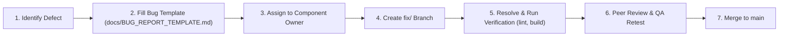

# Team Work & Collaboration Guide — Campus Compass

This document defines the roles, responsibilities, file ownership rules, Git collaboration workflows, local execution steps, and defect tracking processes for the four-member development team building **Campus Compass — The Student Life Assistant**.

---

## 1. Team Role Assignments

| Member | Title & Focus | Core Responsibilities | Primary File Ownership |
| :--- | :--- | :--- | :--- |
| **Member 1** | **Project Foundation & Release Lead** | Scaffolding, React Router configuration, core app routing, integration oversight, production build validation, and release coordination. | `src/app/`, `src/pages/`, `vite.config.js`, `package.json` |
| **Member 2** | **Design System & UI Component Lead** | CSS design tokens (`tokens.css`), responsive typography, global theming (`global.css`), and atomic reusable UI building blocks (`Button`, `Card`, `Badge`, future `Modal`, `Input`). | `src/styles/`, `src/components/ui/` |
| **Member 3** | **App Shell & Navigation Lead** | Responsive application shell, sticky header (`Header.jsx`), persistent footer (`Footer.jsx`), future collapsible sidebar navigation, and mobile view drawer states. | `src/components/layout/` |
| **Member 4** | **Documentation & QA Lead** | Project README guides, testing checklists, manual and automated verification logs, defect tracking, and presentation readiness audit. | `docs/`, `README.md` |

---

## 2. Granular File Ownership Matrix

To eliminate merge conflicts and ensure clear accountability across the team, all members strictly adhere to ownership boundaries:

```
campus-compass/
├── docs/                           --> Member 4 (Docs, testing checklists, bug templates, QA reports)
├── public/                         --> Shared (Favicons, web icons; coordinated with Member 1)
├── src/
│   ├── app/                        --> Member 1 (App shell, AppRoutes centralized routes, main layout)
│   ├── assets/                     --> Shared (Static images, logos, diagrams)
│   ├── components/
│   │   ├── layout/                 --> Member 3 (Header, Footer, future Sidebar, Navigation menus)
│   │   └── ui/                     --> Member 2 (Button, Card, Badge, future Modal, Input, Tabs)
│   ├── features/                   --> Phase 2 Feature Domain Ownership:
│   │   ├── planner/                --> Member 1 & Member 2 (Academic deadlines & assignments)
│   │   ├── calendar/               --> Member 2 & Member 3 (Daily schedules & timetables)
│   │   ├── opportunities/          --> Member 3 & Member 4 (Internships & hackathons)
│   │   ├── placement/              --> Member 1 & Member 4 (DSA trackers & interview prep)
│   │   └── dashboard/              --> Full Team integration
│   ├── hooks/                      --> Shared utility hooks (Peer-reviewed before merging)
│   ├── pages/                      --> Member 1 (HomePage, NotFoundPage, future feature pages)
│   ├── styles/                     --> Member 2 (tokens.css, global.css, resets, variables)
│   ├── utils/                      --> Shared helpers & configuration (config.js)
│   ├── index.css                   --> Member 2
│   └── main.jsx                    --> Member 1
├── .env.example                    --> Member 1 & Member 4 (Template only, no secrets)
├── index.html                      --> Member 1 & Member 4
├── package.json                    --> Member 1 (Lead coordination)
└── README.md                       --> Member 4
```

---

## 3. Git Branching & Workflow Conventions

### A. Designated Branch Naming
All work is conducted in isolated branches. **Direct commits to `main` are strictly prohibited.**

Standard branch conventions:
- **Phase 1 Baseline Branches:**
  - `feature/project-foundation` (Member 1: Scaffolding, router, routing shell)
  - `feature/design-system` (Member 2: Design tokens, Button, Card, Badge)
  - `feature/app-shell` (Member 3: Header, Footer, responsive layout wrappers)
  - `docs/quality-assurance` (Member 4: Documentation, testing checklists, QA audits)
- **Feature Branches (Phase 2):**
  - `feature/<module-name>` (e.g., `feature/assignment-planner`, `feature/timetable-grid`)
- **Bug Fix Branches:**
  - `fix/<issue-id>-<short-description>` (e.g., `fix/header-mobile-padding`, `fix/notfound-nav`)
- **Documentation Branches:**
  - `docs/<topic-name>` (e.g., `docs/update-testing-matrix`)

### B. Pull Request (PR) & Code Review Protocol
1. **Branch Freshness:** Before submitting a PR, rebase against the latest `main`:
   ```bash
   git checkout main
   git pull origin main
   git checkout feature/your-feature-name
   git rebase main
   ```
2. **Pre-PR Health Check:** The PR author must verify that:
   - `npm run lint` passes with 0 errors.
   - `npm run build` succeeds cleanly.
3. **Mandatory Peer Review:**
   - Every PR requires review and sign-off from at least one non-author team member.
   - Member 1 performs final integration review before merging into `main`.
4. **Clean Commits:** Write clear commit messages following Conventional Commits (`feat:`, `fix:`, `docs:`, `chore:`, `test:`).

---

## 4. Shared File Concurrency & Conflict Prevention Rules

To prevent conflicting edits to shared files (`package.json`, `package-lock.json`, `index.html`, `src/app/routes.jsx`, `src/utils/config.js`):

1. **Prior Communication Rule:** Never alter a shared file without informing the team in the collaboration channel and receiving approval from Member 1.
2. **Dependency Management:** Only Member 1 installs new top-level packages or updates `package.json` and `package-lock.json` unless explicitly coordinated.
3. **Atomic Edits:** When modifying shared files, make targeted edits to specific lines only; avoid running automated bulk reformatters that modify untouched lines.
4. **Sequential Route Registration:** When a new page is completed in a feature branch, coordinate route registration in `src/app/routes.jsx` with Member 1 rather than having multiple branches edit the router concurrently.

---

## 5. How to Run the Project Locally

Follow these steps to set up and run the application in a local development environment:

### Prerequisites
- **Node.js**: v18.0.0 or later (v20+ or v22+ recommended)
- **npm**: v9.0.0 or later
- **Git**: v2.30+

### Setup Instructions
```bash
# 1. Clone the repository
git clone <repository-url>
cd campus-compass

# 2. Check out the appropriate branch
git checkout <branch-name>

# 3. Install dependencies
npm install

# 4. Set up local environment variables
cp .env.example .env
# Note: On Windows PowerShell use: Copy-Item .env.example .env

# 5. Start the local development server
npm run dev
```

The application will be accessible at:
```
http://localhost:5173/
```

### Verification Commands
```bash
# Run code health and static linting
npm run lint

# Build production bundle
npm run build

# Preview production build locally
npm run preview
```

---

## 6. How to Report and Fix Bugs

Quality assurance and defect resolution follow a structured lifecycle:



### Reporting Steps
1. When a defect, broken link, layout overflow, or console warning is discovered, create an issue entry based on [`docs/BUG_REPORT_TEMPLATE.md`](BUG_REPORT_TEMPLATE.md).
2. Assign the defect according to the file ownership matrix in Section 1:
   - Routing or build issues -> **Member 1**
   - Styling, CSS tokens, or UI component behavior -> **Member 2**
   - Header, footer, shell navigation, or layout overflow -> **Member 3**
   - Documentation, QA checklists, or test gaps -> **Member 4**
3. The assigned developer creates a `fix/<bug-id>-<description>` branch.
4. After implementing the fix, verify locally with `npm run lint` and `npm run build`.
5. Member 4 re-tests the fix against [`docs/TESTING_CHECKLIST.md`](TESTING_CHECKLIST.md) before the PR is merged into `main`.

---

## 7. Phase Roadmap & Current Hand-off Status

| Phase | Description | Current Status |
| :--- | :--- | :--- |
| **Phase 1: Foundation & App Shell** | Scaffolding, React 19 + Vite 8 setup, React Router baseline, design tokens, Button/Card/Badge components, Header, Footer, and QA documentation. | **100% Completed & Verified** |
| **Phase 2: Core Feature Modules** | Interactive assignments planner, weekly timetable grid, internships/hackathons directory, DSA practice tracker, and collapsible sidebar. | **Pending (Next Milestone)** |
| **Phase 3: Client Persistence & Polish** | LocalStorage state synchronization, custom filters, study streak analytics, dark/light theme toggle, and final presentation readiness. | **Planned** |
